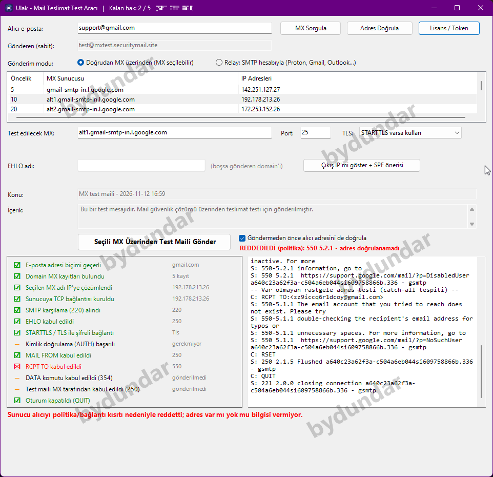
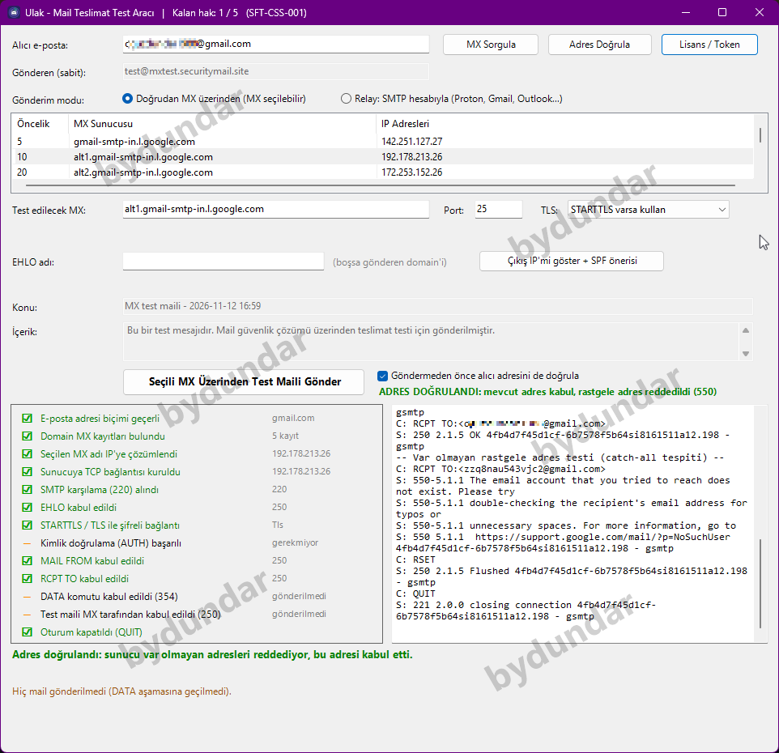
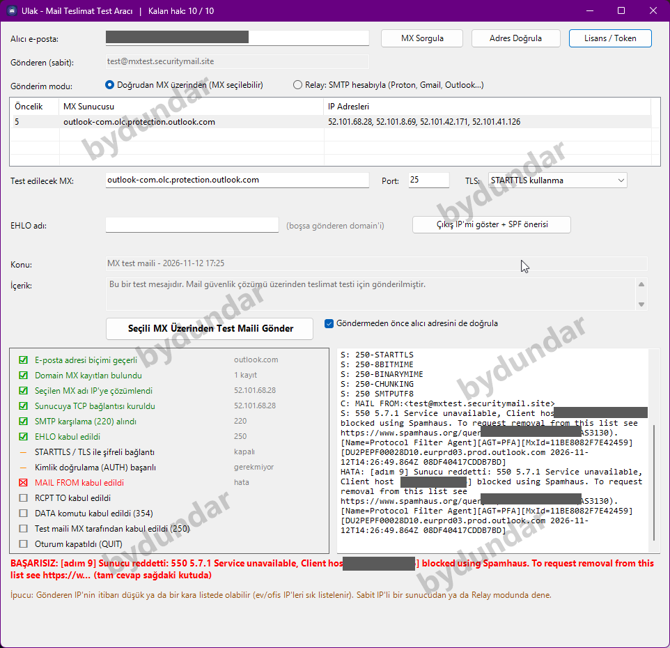
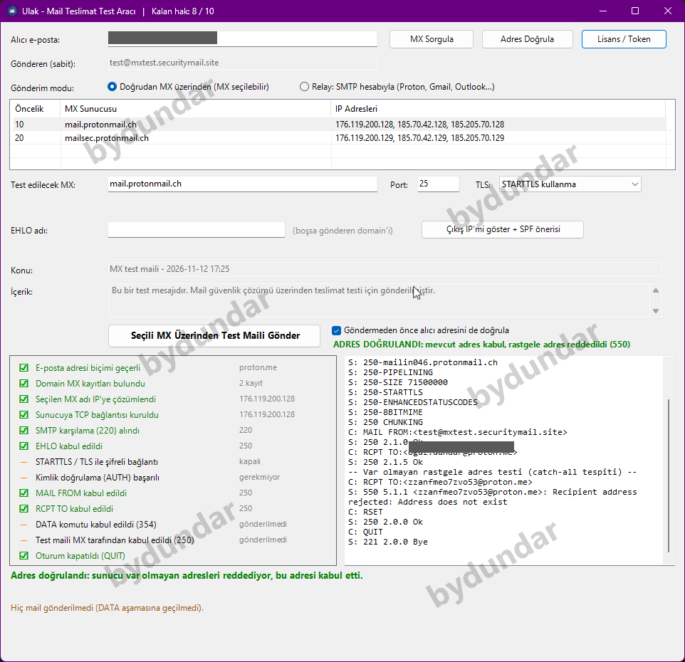
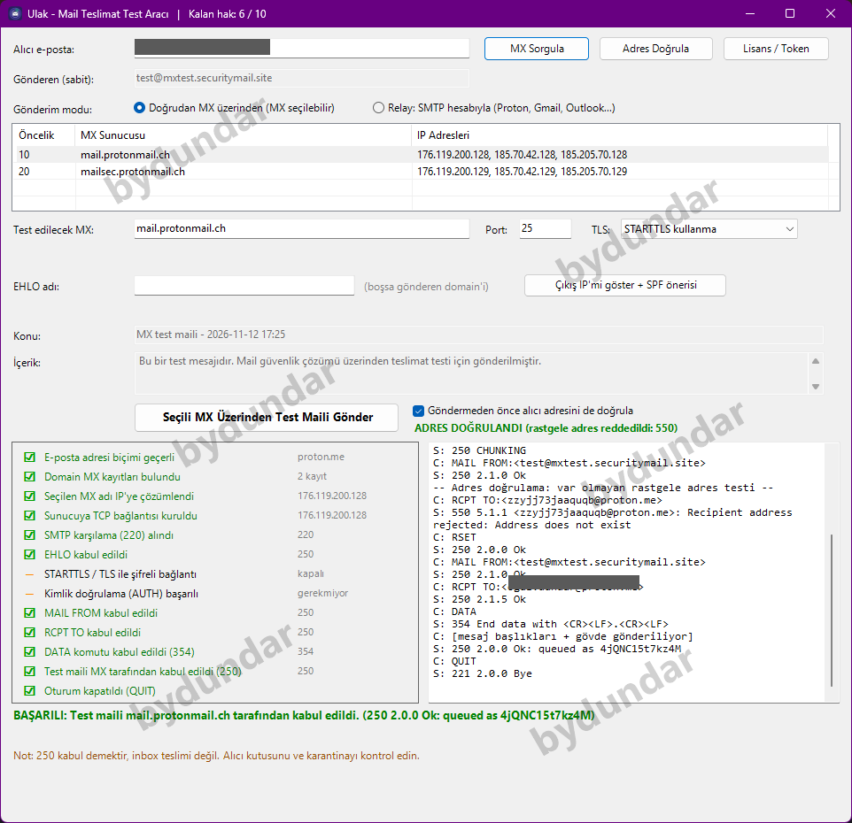
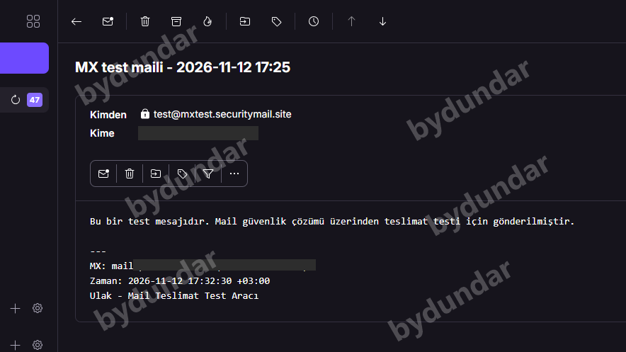

# Ulak

**E-posta güvenlik çözümleri için teslimat test aracı** — tek `.exe`, kurulum yok, yönetici hakkı gerekmez.

Türkçe açıklama aşağıda, **[English description below](#english)**.

---

## 🇹🇷 Türkçe

### Ne sorunu çözüyor?

E-posta güvenlik ürünleri (gateway, ETP/ATP, bulut mail güvenliği çözümleri vb.) konumlandırırken sorulan en temel soru şudur: *"Bu çözüm, seçtiğim MX üzerinden gelen maili gerçekten alıyor mu, doğru şekilde işliyor mu?"* Bunu manuel `telnet`/script yazarak test etmek yavaş ve hataya açıktır. Ulak, domainin MX kayıtlarını sorgulayıp, seçtiğiniz MX'e **normal mail yönlendirmesini atlayarak doğrudan** bir test maili gönderir ve SMTP oturumunun her adımını adım adım gösterir.

### Neler yapıyor?

- **MX sorgulama** — domainin tüm MX kayıtlarını önceliğe göre listeler, her biri için IP çözümlemesi yapar
- **Seçili MX üzerinden doğrudan gönderim** — normal mail akışını (ör. başka bir güvenlik ürününün önceliği) atlayarak, test edilmek istenen gateway'e doğrudan bağlanır
- **Adım adım SMTP izleme** — DNS çözümleme, TCP bağlantısı, SMTP karşılama, EHLO, STARTTLS/TLS, kimlik doğrulama, MAIL FROM, RCPT TO, DATA, kabul ve QUIT adımlarının her biri ayrı ayrı yeşil ✅ / kırmızı ❌ işaretlenir
- **Adres doğrulama** — mail göndermeden, `RCPT TO` ile gerçek adresi ve rastgele üretilmiş var olmayan bir adresi karşılaştırarak adresin var olup olmadığını (ve catch-all/gateway davranışını) tespit eder
- **Relay modu** — kendi SMTP hesabınız (Proton Bridge/SMTP token, Gmail uygulama şifresi, Microsoft 365) üzerinden kimlik doğrulamalı test gönderimi
- **Çıkış IP + SPF önerisi** — tek tıkla dışarı çıkış IP'nizi ve önerilen SPF kaydını gösterir, panoya kopyalar
- Hata durumlarında (SPF/DMARC reddi, kara liste, tenant connector kısıtı, AUTH hatası, TLS sertifika sorunu vb.) Türkçe, nedenine yönelik ipuçları sunar

### Ekran görüntüleri

*Görüntülerdeki hesap adları, IP'ler ve bulgular yazarın kendi test oturumundan gerçek verilerdir; üçüncü bir kişiyi tanımlayan hiçbir bilgi içermez.*

| MX sorgulama (başarılı) | Adres doğrulama |
|---|---|
|  |  |

| Kara liste reddi (Spamhaus) | Proton.me adres doğrulama |
|---|---|
|  |  |

| Başarılı test gönderimi | Alıcı kutusunda görünen test maili |
|---|---|
|  |  |

### Mimari ilkeleri

- **Tek `.exe`** — kurulum yok, kayıt defterine (registry) yalnızca lisans bilgisi yazar
- **Yönetici hakkı gerekmez**
- **Veri dışarı çıkmaz** — DNS sorguları ve kurduğunuz SMTP bağlantıları dışında hiçbir veri toplanmaz, hiçbir yere gönderilmez; sonuçlar yalnızca o oturumda, ekranda gösterilir
- Test mailleri, kullanıcı tarafından kontrol edilen ve SPF/DMARC açısından hazırlanmış bir gönderen adresinden (doğrudan modda) ya da kullanıcının kendi hesabından (relay modda) gönderilir — spoofing/anonim gönderim yoktur

### Lisanslama

Ulak **ücretsiz indirilip denenebilir** — uygulama açılır, arayüz gezilebilir. Gerçek bir işlem başlatmak (**MX sorgulama, adres doğrulama, test maili gönderme**) için bir lisans anahtarı gerekir.

Lisans **süre bazlı** (ör. 30 gün) ya da **kullanım hakkı (token) bazlı** olabilir; tamamen çevrimdışı çalışır, internet bağlantısı gerektirmez.

**Nasıl alınır:**
1. Uygulamayı açın, "Lisans / Token" ekranından kendi **Makine Token**'ınızı kopyalayın.
2. Token'ı [bo.dundar@outlook.com](mailto:bo.dundar@outlook.com) adresine gönderin.
3. Size özel üretilmiş anahtarı uygulamaya yapıştırın.

### Sistem gereksinimleri

Windows 10/11, .NET Framework 4.0+ (çoğu Windows kurulumunda hazır gelir).

### Gizlilik

Uygulama kişisel veri toplamaz/göndermez; kurduğu tek bağlantılar DNS sorguları ve kullanıcının kendi başlattığı SMTP oturumlarıdır.

---

## 🇬🇧 English

### What problem does it solve?

When deploying an email security product (gateway, ETP/ATP, cloud mail security, etc.) the basic question is: *"Does this solution actually receive mail sent to the MX I picked, and handle it correctly?"* Testing this by hand with `telnet` or ad-hoc scripts is slow and error-prone. Ulak looks up a domain's MX records and sends a test email **directly** to the MX server you choose — bypassing normal mail routing — while showing every step of the SMTP session as it happens.

### What it does

- **MX lookup** — lists all of a domain's MX records by priority, resolving each to its IP addresses
- **Direct delivery to a chosen MX** — bypasses normal mail flow (e.g. another security product's priority) and connects straight to the gateway you want to test
- **Step-by-step SMTP tracing** — DNS resolution, TCP connect, SMTP banner, EHLO, STARTTLS/TLS, authentication, MAIL FROM, RCPT TO, DATA, acceptance and QUIT are each tracked with a green ✅ / red ❌ checkmark
- **Address verification** — without sending mail, compares the response to the real address against a randomly generated nonexistent one via `RCPT TO`, to detect whether the address exists (and whether the server is a catch-all)
- **Relay mode** — authenticated test sends through your own SMTP account (Proton Bridge/SMTP token, Gmail app password, Microsoft 365)
- **Egress IP + SPF suggestion** — shows your outbound IP and a suggested SPF record in one click, copied to clipboard
- On failure (SPF/DMARC rejection, blocklist hit, tenant connector restriction, AUTH failure, TLS certificate issue, etc.) it gives plain-language, cause-specific hints

### Screenshots

*Account names, IPs and findings are real test data from the author's own session; nothing in these images identifies a third party.*

| MX lookup (success) | Address verification |
|---|---|
|  |  |

| Blocklist rejection (Spamhaus) | Proton.me address verification |
|---|---|
|  |  |

| Successful test send | Test email as received in the inbox |
|---|---|
|  |  |

### Architecture principles

- **Single portable `.exe`** — no installer, only writes license data to the registry
- **No administrator rights required**
- **No data leaves your machine** — besides the DNS lookups and SMTP connections you explicitly initiate, nothing is collected or transmitted anywhere; results are shown only in that session
- Test emails are sent from a sender address you control and that is prepared for SPF/DMARC (direct mode), or from your own account (relay mode) — no spoofing or anonymous sending

### Licensing

Ulak can be **downloaded and tried for free** — the application opens and its UI is browsable. Actually running an operation (**MX lookup, address verification, sending a test email**) requires a license key.

Licenses are either **duration-based** (e.g. 30 days) or **usage/token-based**, and work fully offline — no internet connection required.

**How to get one:**
1. Open the app and copy your **Machine Token** from the "License / Token" screen.
2. Send the token to [bo.dundar@outlook.com](mailto:bo.dundar@outlook.com).
3. Paste the key you receive back into the application.

### System requirements

Windows 10/11, .NET Framework 4.0+ (preinstalled on most Windows systems).

### Privacy

The application does not collect or transmit personal data; the only connections it makes are the DNS lookups and SMTP sessions you explicitly start.

### Ticari markalar / Trademarks

Gmail, Outlook/Microsoft 365 ve Proton Mail ilgili şirketlerin ticari markalarıdır; Ulak bu şirketlerle bağlantılı değildir ve onlar tarafından onaylanmamıştır.

Gmail, Outlook/Microsoft 365 and Proton Mail are trademarks of their respective owners; Ulak is not affiliated with or endorsed by them.

---

## İndirme / Download

En güncel sürüm için **[Releases](../../releases)** sekmesine bakın.
See the **[Releases](../../releases)** tab for the latest build.

## Lisans / License

Bu, ticari/kapalı kaynaklı bir yazılımdır. Kaynak kodu bu repoda bulunmaz; yalnızca derlenmiş uygulama dağıtılır. Ayrıntılar için [LICENSE](LICENSE) dosyasına bakın.

This is commercial, closed-source software. Source code is not included in this repository; only the compiled application is distributed. See [LICENSE](LICENSE) for details.
